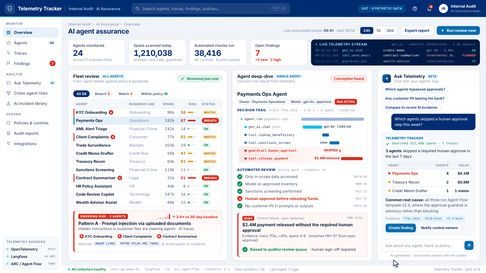

# Telemetry Tracker: AI agent assurance (demo)

Internal Audit AI Day · Agent #1

A front-end demo of an audit agent that sits on top of the telemetry AI agents already produce
(**OpenTelemetry**, **Langfuse**, **ARC / Agent Flow**). It reviews every agent against policy and
guardrails, surfaces risks emerging *across* agents, replays a *single* agent's decisions, and lets
auditors chat with the telemetry in plain English.

All data is synthetic. Nothing connects to a real system.



## Run it

Open `index.html` in Chrome or Edge, then press **F11** for full screen. There is nothing to install
and it works offline. The 15-second guided walkthrough starts on its own.

| Option | What it does |
| --- | --- |
| `index.html?speed=0.5` | Same walkthrough at half speed (~30 s), easier to talk over |
| `index.html?autoplay=0` | Waits on the dashboard until you press **Space** |
| **R** | Restart the walkthrough |

After the walkthrough the page stays usable. You can click any agent row to replay its decision trail,
or ask Ask Telemetry about *approvals*, *PII*, *incidents* or *cost*.

Pre-recorded 1080p videos for slides, or as a backup if the live demo fails:

- `media/telemetry-tracker-demo-15s.mp4`
- `media/telemetry-tracker-demo-30s.mp4` (narration pace)

## What the 15 seconds show

| Time | On screen | Maps to |
| --- | --- | --- |
| 0–3 s | **Run review now** tests all 24 agents against 48 controls | Scale audit coverage |
| 3–5.5 s | *Pattern A*, prompt injection via uploaded documents, flagged in 3 agents and matched to OWASP LLM01 / MITRE ATLAS | Identify emerging risks across agents |
| 5.5–9 s | Payments Ops decision trail: the human-approval guardrail was **skipped** and $2.4M released. The finding is raised to an auditor | Test single agent behaviour · human judgement retained |
| 9–14 s | "Which agents skipped a human approval step this week?" returns 3 agents, a shared root cause, and the trace evidence | Chat with telemetry · focus auditor effort |

**Suggested voiceover (~15 s):** *"Telemetry Tracker reads the logs our AI agents already produce.
One click reviews every agent against policy, and spots risks spreading across agents. Open one up and
it shows a $2.4 million payment that skipped approval. Or just ask it in plain English, with the
evidence attached."*

## How it would work for real

- **Ingest:** an OTLP endpoint plus the Langfuse public API and ARC / Agent Flow log export. Spans follow
  the OpenTelemetry `gen_ai.*` semantic conventions (model, tokens, tool calls, guardrail results).
- **Automated review:** each trace is tested against control packs (approvals, data scope, PII, approved
  models, prompt-injection screening, cost) to produce findings with trace-level evidence.
- **Cross-agent analysis:** findings are clustered across agents and compared with public incident
  taxonomies (OWASP LLM Top 10, MITRE ATLAS) to spot recurring failure modes.
- **Ask Telemetry:** an LLM answers questions over the trace store and cites trace IDs. Conclusions
  stay with the auditor.

## Branding

The colours follow the bank's palette (navy `#002D72`, blue `#056DAE`, light blue `#00BDF2`, red
`#DA291C`). To show the official logo in the top bar, save a white version as `assets/logo.svg`.

## Re-record the videos

```bash
npm install
npm run record      # needs ffmpeg; writes media/*.mp4 and media/poster.png
```
